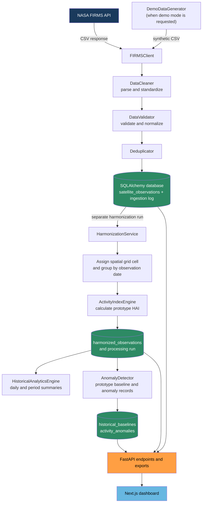

# FireDNA — Data Pipeline Design
## NASA Space Apps Challenge 2026

**Version:** 1.0.0  
**Date:** November 10, 2026

---

## 1. Pipeline Overview

The FireDNA data pipeline is a linear, audited processing chain that transforms raw NASA FIRMS CSV data into clean observations, harmonized grid metrics, historical baselines, and anomaly scores. Each stage is a separate Python module with clear inputs, outputs, and logging.



---

## 2. Stage 1 — NASA FIRMS API Client

**Module:** `backend/app/ingestion/firms_client.py`

### Responsibilities
- Construct valid FIRMS API request URLs.
- Execute HTTP GET requests with timeout and retry logic.
- Return raw CSV text or raise typed exceptions.
- Log request metadata (URL, response code, response size).

### FIRMS API URL Format
```
https://firms.modaps.eosdis.nasa.gov/api/area/csv/{MAP_KEY}/{PRODUCT}/{BBOX}/{DATE_RANGE}
```

Where:
- `MAP_KEY` = NASA FIRMS API key (from environment)
- `PRODUCT` = `MODIS_NRT`, `VIIRS_SNPP_NRT`, `VIIRS_NOAA20_NRT`, or `VIIRS_NOAA21_NRT`
- `BBOX` = `min_lon,min_lat,max_lon,max_lat` (note: lon before lat in FIRMS format)
- `DATE_RANGE` = `YYYY-MM-DD` (single day) or `YYYY-MM-DD/YYYY-MM-DD` (range, up to 10 days NRT)

### Key Implementation Notes
- NRT products are limited to the past 10 days. Use archive API for older data.
- Timeout: 30 seconds total, 10 seconds connection.
- Retry: 3 attempts with exponential backoff (2s, 4s, 8s).
- If `MAP_KEY` is not configured, raise `FIRMSAuthError` and activate demo mode.
- Never log the MAP_KEY value; log the first 4 characters only for debugging.

### Demo Mode Activation
```python
if not settings.FIRMS_MAP_KEY:
    logger.warning("FIRMS_MAP_KEY not configured. Activating demo mode.")
    return DemoDataGenerator.generate_csv(product=product, bbox=bbox, date_range=date_range)
```

---

## 3. Stage 2 — CSV Parser and Field Standardization

**Module:** `backend/app/ingestion/data_cleaner.py`

### MODIS NRT CSV Fields

| FIRMS Field | FireDNA Field | Type | Notes |
|---|---|---|---|
| latitude | latitude | float | Direct |
| longitude | longitude | float | Direct |
| brightness | brightness | float | Brightness temp (K), channel 21/22 |
| scan | scan | float | Along-scan pixel size |
| track | track | float | Along-track pixel size |
| acq_date | acq_date | date | YYYY-MM-DD |
| acq_time | acq_time | time | HHMM (4-digit) → HH:MM:00 |
| satellite | satellite_platform | str | 'T' → 'Terra', 'A' → 'Aqua' |
| instrument | instrument | str | Always 'MODIS' |
| confidence | confidence_raw | str | 'low', 'nominal', 'high' |
| version | version | str | Collection version |
| bright_t31 | bright_t31 | float | Channel 31 brightness temp |
| frp | frp | float | Fire Radiative Power (MW) |
| daynight | daynight | str | 'D' or 'N' |

### VIIRS NRT CSV Fields

| FIRMS Field | FireDNA Field | Type | Notes |
|---|---|---|---|
| latitude | latitude | float | Direct |
| longitude | longitude | float | Direct |
| bright_ti4 | brightness | float | I-band 4 brightness temp (K) |
| scan | scan | float | Along-scan pixel size |
| track | track | float | Along-track pixel size |
| acq_date | acq_date | date | YYYY-MM-DD |
| acq_time | acq_time | time | HHMM → HH:MM:00 |
| satellite | satellite_platform | str | 'N' → 'Suomi-NPP', 'N20' → 'NOAA-20', 'N21' → 'NOAA-21' |
| instrument | instrument | str | Always 'VIIRS' |
| confidence | confidence_raw | str | '0'–'100' (integer percentage) |
| version | version | str | Collection version |
| bright_ti5 | bright_t31 | float | I-band 5 (stored in bright_t31 field) |
| frp | frp | float | Fire Radiative Power (MW) |
| daynight | daynight | str | 'D' or 'N' |
| type | — | int | 0=fire, 1=volcano, 2=other (filter: keep type=0) |

### Transformation Steps
1. Parse CSV with `pandas.read_csv()` using `dtype=str` (read all as string first for safe parsing).
2. Strip whitespace from all string fields.
3. Convert `acq_time` from HHMM to HH:MM:SS format.
4. Map satellite abbreviations to full names.
5. Map VIIRS `type` column: exclude records where `type != 0` (non-fire detections).
6. Add `instrument` field based on product type.
7. Add `source_product` field (original product name).
8. Preserve all original fields in `raw_metadata` as a dict.

---

## 4. Stage 3 — Data Validation

**Module:** `backend/app/ingestion/data_validator.py`

### Validation Rules

| Field | Rule | Action on Failure |
|---|---|---|
| latitude | -90 ≤ lat ≤ 90 | Reject record, log warning |
| longitude | -180 ≤ lon ≤ 180 | Reject record, log warning |
| acq_date | Valid date, not future, within 365 days | Reject record |
| frp | frp ≥ 0.0 (allow NULL) | Set to NULL if negative |
| brightness | 200 ≤ brightness ≤ 2000 (physical bounds) | Flag as suspicious, retain |
| confidence_raw | MODIS: {'low','nominal','high'}; VIIRS: 0–100 | Flag, retain with 'low' confidence |
| daynight | {'D','N'} | Allow NULL |

### Confidence Normalization

```python
def normalize_confidence(raw: str, instrument: str) -> tuple[float, str]:
    """
    Normalize raw FIRMS confidence to [0.0, 1.0] and category.

    MODIS: categorical → numeric
        'low'     → 0.33, 'low'
        'nominal' → 0.66, 'nominal'
        'high'    → 1.00, 'high'

    VIIRS: numeric percentage → fraction
        0–30   → 0.0–0.30, 'low'
        30–70  → 0.30–0.70, 'nominal'
        70–100 → 0.70–1.00, 'high'

    Returns: (normalized_value: float, category: str)
    """
```

### Validation Report
Each validation run produces a summary:
```json
{
  "total_input": 1000,
  "valid": 980,
  "rejected_coordinate": 5,
  "rejected_date": 3,
  "flagged_suspicious": 12,
  "non_fire_type_excluded": 15
}
```

---

## 5. Stage 4 — Deduplication

**Module:** `backend/app/ingestion/deduplicator.py`

### Deduplication Key
```
(latitude, longitude, acq_date, acq_time, instrument, satellite_platform)
```

### Strategy
1. Compute SHA-256 hash of deduplication key fields.
2. Query database for existing hashes in the target date range.
3. Filter out records already in database.
4. For records with NULL `acq_time`, use `(latitude, longitude, acq_date, instrument, satellite_platform)`.

### Why Not Distance-Based Deduplication
FireDNA does NOT remove records based on geographic proximity. Two nearby hotspots from different satellite passes or different satellites may represent the same fire from different viewing angles, but they are distinct satellite observations. Removing them would destroy scientific data. Deduplication is only for identical records ingested twice (e.g., re-running ingestion for the same date).

---

## 6. Stage 5 — Database Insertion

Records are bulk-inserted using SQLAlchemy's `insert()` with `ON CONFLICT DO NOTHING` to handle any remaining edge-case duplicates at the database level. Each insertion is wrapped in a transaction; if any error occurs, the entire batch rolls back and the error is logged to `data_ingestion_logs`.

---

## 7. Stage 6 — Spatial Harmonization

**Module:** `backend/app/harmonization/spatial.py`

### Grid Generation
```python
def generate_grid(bbox: BoundingBox, resolution_deg: float) -> GeoDataFrame:
    """
    Generate a regular latitude-longitude grid of square cells.

    Parameters:
        bbox: Geographic bounding box
        resolution_deg: Cell size in decimal degrees (default: 0.1°)

    Returns:
        GeoDataFrame with columns: grid_cell_id, geometry (Polygon),
        lat_min, lat_max, lon_min, lon_max, centroid

    Grid cell ID format: "G_{lat_min:.2f}N_{lon_min:.2f}E_{resolution:.1f}D"
    Example: "G_23.40N_90.10E_0.1D"

    Note: 0.1° ≈ 11 km at equator. This is intentionally coarser than
    VIIRS resolution (375m) and MODIS resolution (~1km) to aggregate
    detections from both sensors into comparable units.
    """
```

### Spatial Join
```python
# Assign each observation to its grid cell using spatial join
obs_gdf = gpd.GeoDataFrame(observations, geometry=gpd.points_from_xy(obs.longitude, obs.latitude))
grid_assigned = gpd.sjoin(obs_gdf, grid_gdf, how='left', predicate='within')
```

### MODIS Spatial Considerations
MODIS pixel size varies from ~1 km nadir to ~2 km at swath edges (reported in `scan` and `track` fields). At 0.1° grid resolution, a single MODIS pixel almost always falls within one cell. No pixel-splitting is performed in the MVP.

### VIIRS Spatial Considerations
VIIRS pixels are 375m, so multiple VIIRS pixels from a single fire will typically fall within the same 0.1° cell. The count in each cell represents distinct fire detection points, not distinct fire events.

---

## 8. Stage 7 — Temporal Harmonization

**Module:** `backend/app/harmonization/temporal.py`

### Temporal Window Assignment
```python
def assign_temporal_window(observations: DataFrame, window_hours: int = 24) -> DataFrame:
    """
    Assign each observation to a temporal window bucket.
    Default: 24-hour UTC day windows (obs_date = acq_date in UTC).

    For sub-daily windows (e.g., 6 hours):
        window_id = floor(acq_datetime.hour / window_hours)
        window_start = obs_date + timedelta(hours=window_id * window_hours)

    Important: All times are UTC. No local timezone conversion.
    Satellite overpass times differ between MODIS and VIIRS sensors.
    For 24-hour windows, overpass differences are within the same day
    for most cases at mid-latitudes.
    """
```

### Satellite Overpass Context
- MODIS Terra: approximately 10:30 AM and 10:30 PM local time (descending and ascending node).
- MODIS Aqua: approximately 1:30 PM and 1:30 AM local time.
- VIIRS Suomi-NPP: approximately 1:30 PM local time (descending node).
- VIIRS NOAA-20: approximately 1:30 PM local time (descending node, ~50 minutes offset from SNPP).
- VIIRS NOAA-21: approximately 1:30 PM local time.

For 24-hour temporal windows, overpass differences are immaterial. For sub-daily analysis, the temporal offset between MODIS and VIIRS must be noted in results.

---

## 9. Stage 8 — Sensor Normalization

**Module:** `backend/app/harmonization/normalization.py`

### FRP Normalization
FRP (Fire Radiative Power) is provided in megawatts (MW) by both MODIS and VIIRS via FIRMS. However, the absolute FRP values are **not directly comparable** between sensors due to:
1. Different pixel sizes (MODIS ~1km vs VIIRS 375m).
2. Different spectral bands used for detection.
3. Different detection thresholds.

FireDNA's normalization approach for HAI computation:
- Uses **log-transformed, min-max normalized FRP** within each sensor independently.
- Does NOT assert that MODIS FRP = VIIRS FRP for the same fire.
- Preserves original FRP values without modification for scientific use.

```python
def normalize_frp_log(frp_series: pd.Series) -> pd.Series:
    """
    Log-transform FRP values, then normalize to [0, 1] within the series.
    FRP = 0 maps to 0 after normalization.
    Uses log1p to handle zero FRP gracefully.

    WARNING: This normalization is relative to the current dataset only.
    It is NOT a calibrated absolute measurement. It is used only for
    the experimental HAI score computation.
    """
    log_frp = np.log1p(frp_series.fillna(0))
    max_val = log_frp.max()
    if max_val == 0:
        return pd.Series(0.0, index=frp_series.index)
    return log_frp / max_val
```

### Count Normalization
Detection counts are normalized per sensor by dividing by the expected maximum detections per cell per day. In practice, counts are normalized relative to the 95th percentile of observed counts in the dataset to avoid distortion from extreme outliers.

---

## 10. Stage 9 — Harmonized Activity Index

**Module:** `backend/app/harmonization/activity_index.py`

**See:** `HARMONIZATION_METHODOLOGY.md` for the complete mathematical specification.

**Summary:** HAI is computed as a weighted sum of three normalized components:
1. Normalized detection count score (40% weight).
2. Normalized FRP score (45% weight).
3. Mean confidence score (15% weight).

HAI is explicitly labeled as experimental throughout all documentation, APIs, and UI.

---

## 11. Stages 11–13 — Analytics and Anomaly Detection

**See:** `HARMONIZATION_METHODOLOGY.md` for the anomaly detection algorithm.

**Key safety rules:**
- If `sample_years < 3`, baseline is flagged as `is_sufficient = FALSE` and anomaly scores are marked `has_sufficient_baseline = FALSE`.
- If `std_count == 0`, Z-score computation is skipped and anomaly level is set to `'insufficient_data'`.
- Division by zero is explicitly handled in all statistical calculations.

---

## 12. Demo Mode Pipeline

When `FIRMS_MAP_KEY` is not set:

1. `firms_client.py` returns synthetic CSV data generated by `DemoDataGenerator`.
2. Synthetic data follows realistic statistical distributions for Bangladesh.
3. All synthetic records are inserted with `is_demo_data = TRUE`.
4. All API responses include `"is_demo_data": true` in the `meta` field.
5. The frontend displays a prominent orange banner: **"⚠️ Demo Data — Not Real NASA Observations"**.
6. Demo data is never mixed with real observations in the same ingestion run.

---

## 13. Pipeline Configuration

All pipeline parameters are configurable via environment variables and stored with each processing run:

```python
class PipelineConfig:
    # Spatial harmonization
    GRID_RESOLUTION_DEG: float = 0.1        # Grid cell size in degrees

    # Temporal harmonization
    TEMPORAL_WINDOW_HOURS: int = 24         # Time window size

    # HAI weights (must sum to 1.0)
    HAI_COUNT_WEIGHT: float = 0.40
    HAI_FRP_WEIGHT: float = 0.45
    HAI_CONFIDENCE_WEIGHT: float = 0.15

    # Anomaly detection thresholds
    ANOMALY_ELEVATED_Z: float = 1.5
    ANOMALY_HIGH_Z: float = 2.5
    ANOMALY_EXTREME_Z: float = 3.5
    MIN_BASELINE_YEARS: int = 3

    # Ingestion
    FIRMS_MAX_DATE_RANGE_DAYS: int = 10     # NRT API limit
    FIRMS_REQUEST_TIMEOUT_S: int = 30
    FIRMS_MAX_RETRIES: int = 3

    # API limits
    MAX_GEOJSON_FEATURES: int = 2000        # Map rendering limit
```

---

*Document version 1.0.0 — FireDNA Data Pipeline Design*
