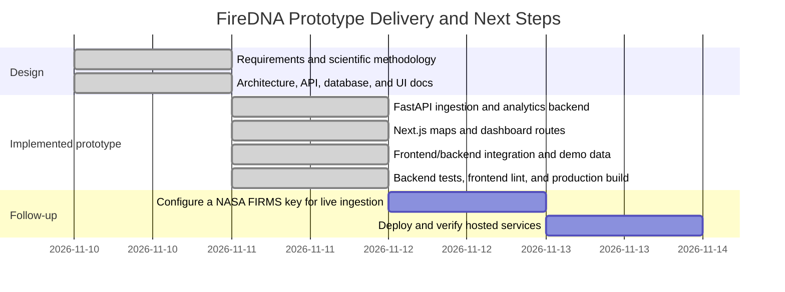

# FireDNA — Development Roadmap & Implementation Plan
## NASA Space Apps Challenge 2026

**Version:** 1.0.0  
**Date:** November 11, 2026
**Status:** Full-stack prototype implemented and verified locally

---

## 1. Project Phase Structure

The initial design and full-stack prototype are implemented. The diagram summarizes delivered work and identifies live-data configuration and production deployment as follow-up steps.



---

## 2. Phase 1: System Design (Completed)

| Deliverable | File Path | Status | Verification |
|---|---|---|---|
| Product Requirements Document | `docs/PRD.md` | ✅ Completed | 35 functional & 10 non-functional requirements |
| System Architecture Design | `docs/SYSTEM_ARCHITECTURE.md` | ✅ Completed | 7 Mermaid architecture & flow diagrams |
| Database & PostGIS Design | `docs/DATABASE_DESIGN.md` | ✅ Completed | Full SQL DDL migration, indexing & schemas |
| REST API Design & Contracts | `docs/API_DESIGN.md` | ✅ Completed | 6 endpoint groups, cURL samples, error models |
| Data Pipeline Architecture | `docs/DATA_PIPELINE.md` | ✅ Completed | 13-stage ingestion & harmonization pipeline |
| Scientific Harmonization Method | `docs/HARMONIZATION_METHODOLOGY.md` | ✅ Completed | Mathematical formulation of HAI & Z-score anomalies |
| UI/UX & Educational Design | `docs/UI_UX_DESIGN.md` | ✅ Completed | 8-page architecture, palette, accessibility specs |
| Development Roadmap | `docs/DEVELOPMENT_ROADMAP.md` | ✅ Completed | Milestone tracking & validation criteria |

---

## 3. Phase 2: Backend Prototype

### 3.1 Objectives
The implemented Python/FastAPI service can ingest FIRMS or demo data, validate observations, store them through SQLAlchemy, calculate harmonized results and anomaly summaries, and serve documented REST endpoints. SQLite is the local default; Docker Compose configures PostgreSQL/PostGIS.

The directory tree below records the original implementation plan. The checked-out source tree is authoritative if a planned file or component differs.

### 3.2 Directory Structure
```
backend/
├── app/
│   ├── __init__.py
│   ├── main.py                  # FastAPI initialization, CORS, routers
│   ├── core/
│   │   ├── __init__.py
│   │   ├── config.py            # Pydantic Settings, environment variables
│   │   └── database.py          # SQLAlchemy async/sync engine, sessionmaker
│   ├── models/
│   │   ├── __init__.py
│   │   └── models.py            # Observation, IngestionLog, Harmonized, Baseline, Anomaly models
│   ├── schemas/
│   │   ├── __init__.py
│   │   └── schemas.py           # Pydantic request/response validation models
│   ├── ingestion/
│   │   ├── __init__.py
│   │   ├── firms_client.py      # NASA FIRMS API HTTP client with retries
│   │   ├── demo_generator.py    # Synthetic Bangladesh dataset generator
│   │   ├── data_cleaner.py      # CSV parser, field mapper, data type standardization
│   │   ├── data_validator.py    # Coordinate, FRP, date, and confidence bounds checking
│   │   └── deduplicator.py      # Composite key deduplication
│   ├── harmonization/
│   │   ├── __init__.py
│   │   ├── spatial.py           # 0.1° grid generation and point-in-polygon mapping
│   │   ├── temporal.py          # 24h UTC window grouping
│   │   ├── normalization.py     # Independent log-minmax FRP & P95 count normalization
│   │   ├── activity_index.py    # Harmonized Activity Index (HAI) computation
│   │   └── validation.py        # Sensor agreement and correlation statistics
│   ├── analytics/
│   │   ├── __init__.py
│   │   ├── historical.py        # Daily, monthly, yearly aggregations
│   │   └── anomaly_detection.py # Monthly baseline means, std dev, Z-scores, percentiles
│   └── api/
│       └── v1/
│           ├── __init__.py
│           ├── ingestion.py     # Ingestion triggers & audit logs
│           ├── hotspots.py      # Hotspot lists, summary & GeoJSON
│           ├── harmonization.py # Harmonization triggers, comparisons & validation
│           ├── analytics.py     # Daily, monthly, yearly, seasonal time series
│           ├── anomalies.py     # Anomaly queries & detection triggers
│           └── exports.py       # CSV and GeoJSON file exports
├── tests/
│   ├── __init__.py
│   ├── conftest.py              # Test database fixtures and mock FIRMS client
│   ├── test_ingestion.py        # Test parser, validator, and deduplicator
│   ├── test_harmonization.py    # Test spatial grid, normalization & HAI calculations
│   ├── test_anomalies.py        # Test Z-score and zero-variance handling
│   └── test_api.py              # Test FastAPI endpoint contracts
├── Dockerfile                   # Production Python 3.11 container
├── docker-compose.yml           # Backend + PostGIS + Frontend stack
├── requirements.txt             # Locked dependencies
└── .env.example                 # Environment configuration template
```

### 3.3 Implemented Milestones
1. **M2.1: Core Infrastructure & Database Models**
   - Environment-based configuration and SQLAlchemy database connectivity (file-based SQLite locally; PostgreSQL in Compose).
   - SQLAlchemy models for observations, processing runs, harmonized results, baselines, and anomalies. The SQL migration in `DATABASE_DESIGN.md` is a design reference and is not run by the application.
2. **M2.2: NASA FIRMS Ingestion Engine**
   - FIRMS HTTP client for supported MODIS and VIIRS products.
   - Demo Data Generator providing synthetic Bangladesh fire events with realistic coordinates and FRP when no key is present.
   - Data cleaning, validation, and deduplication pipeline.
3. **M2.3: Harmonization & Analytics Engines**
   - Spatial grid assignment and daily observation grouping.
   - Sensor normalization and experimental HAI computation.
   - Anomaly classification with explicit insufficient-baseline handling.
4. **M2.4: FastAPI REST API Endpoints**
   - Six API groups under `/api/v1`: ingestion, hotspots, harmonization, analytics, anomalies, and exports.
   - CSV and GeoJSON download endpoints.
   - Auto-generated Swagger documentation at `/docs`.
5. **M2.5: Backend Verification & Test Suite**
   - Comprehensive test suite covering ingestion, harmonization math, anomaly classification, and API status codes.

---

## 4. Phase 3: Frontend Prototype

### 4.1 Objectives
The Next.js 14 application implements the dashboard, interactive map, comparison lab, calendar, analytics, anomalies, data sources, and about pages described in `UI_UX_DESIGN.md`.

### 4.2 Implemented Routes
1. **`/` — Dashboard:** Regional overview, metrics, and entry points.
2. **`/map` — Fire Map:** Leaflet map with satellite observations and harmonized cells.
3. **`/compare` — Sensor Lab:** MODIS, VIIRS, and HAI comparison.
4. **`/calendar` — Fire Calendar:** Daily activity heatmap.
5. **`/analytics` — Analytics:** Daily, monthly, and seasonal charts.
6. **`/anomalies` — Anomalies:** Anomaly summary and historical context.
7. **`/sources` — Data Sources:** FIRMS products, attribution, and provenance.
8. **`/about` — About:** Project and educational information.

---

## 5. Phase 4: Integration & Quality Assurance (Verified)

- The frontend requests backend `/api/v1` data and provides demo fallbacks where available.
- The backend test runner passes its 24 verification checks.
- Frontend lint and production build complete successfully.
- Demo data is visibly labeled; local API and frontend routes were verified together.
- Cross-browser and mobile testing remain follow-up validation tasks.

---

## 6. Phase 5: Hackathon Presentation Readiness

### 6.1 Demonstration Workflow (Step-by-Step)
1. **Welcome to FireDNA:** Introduce the mission and regional focus on Bangladesh and South Asia.
2. **The Satellite Discrepancy:** Show raw MODIS detections vs VIIRS detections on the map to illustrate how different sensor resolutions (1km vs 375m) produce vastly different counts.
3. **The Sensor Comparison Lab:** Demonstrate the 0.1° harmonization grid and how FireDNA unifies observations into an interpretable Harmonized Activity Index (HAI).
4. **Long-Term Patterns:** Examine seasonal agricultural burning via the Fire Activity Calendar and time series charts.
5. **Anomaly Detection:** Highlight statistically significant fire spikes and explain the Z-score calculation without sensationalizing.
6. **Scientific Transparency:** Inspect the Data Sources page, showing NASA FIRMS provenance, processing parameters, and explicit prototype disclaimers.

---

## 7. Prototype Verification

The eight design documents describe the project scope and methodology:
1. `PRD.md`
2. `SYSTEM_ARCHITECTURE.md`
3. `DATABASE_DESIGN.md`
4. `API_DESIGN.md`
5. `DATA_PIPELINE.md`
6. `HARMONIZATION_METHODOLOGY.md`
7. `UI_UX_DESIGN.md`
8. `DEVELOPMENT_ROADMAP.md`

The full-stack prototype is implemented and runs locally in demo mode. Configure a NASA FIRMS key to exercise live ingestion, then deploy and verify the hosted services before treating the project as production-ready.
