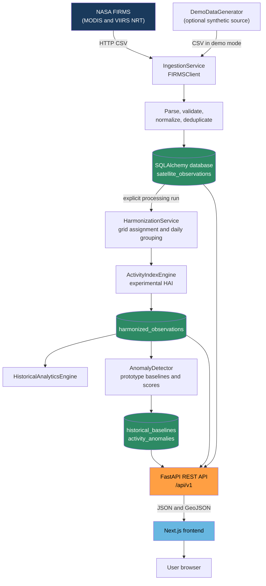
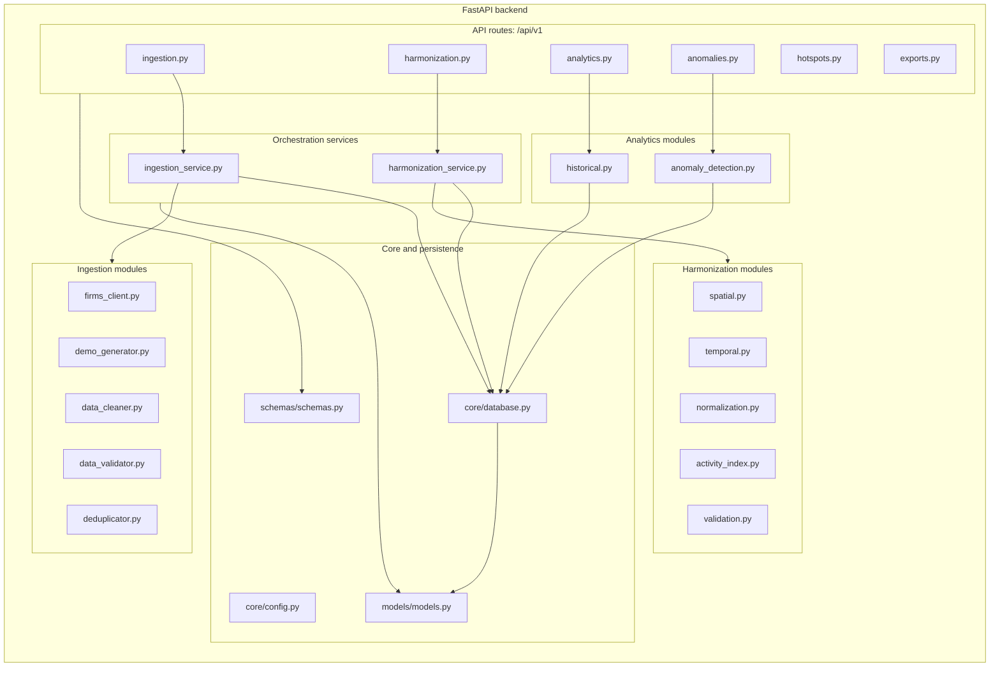
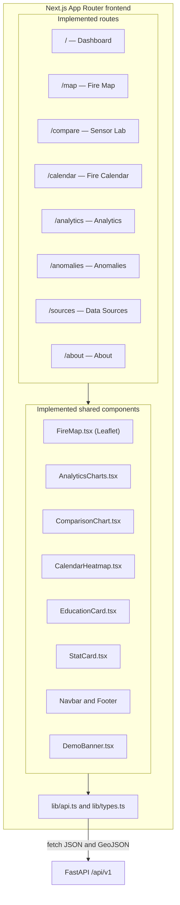
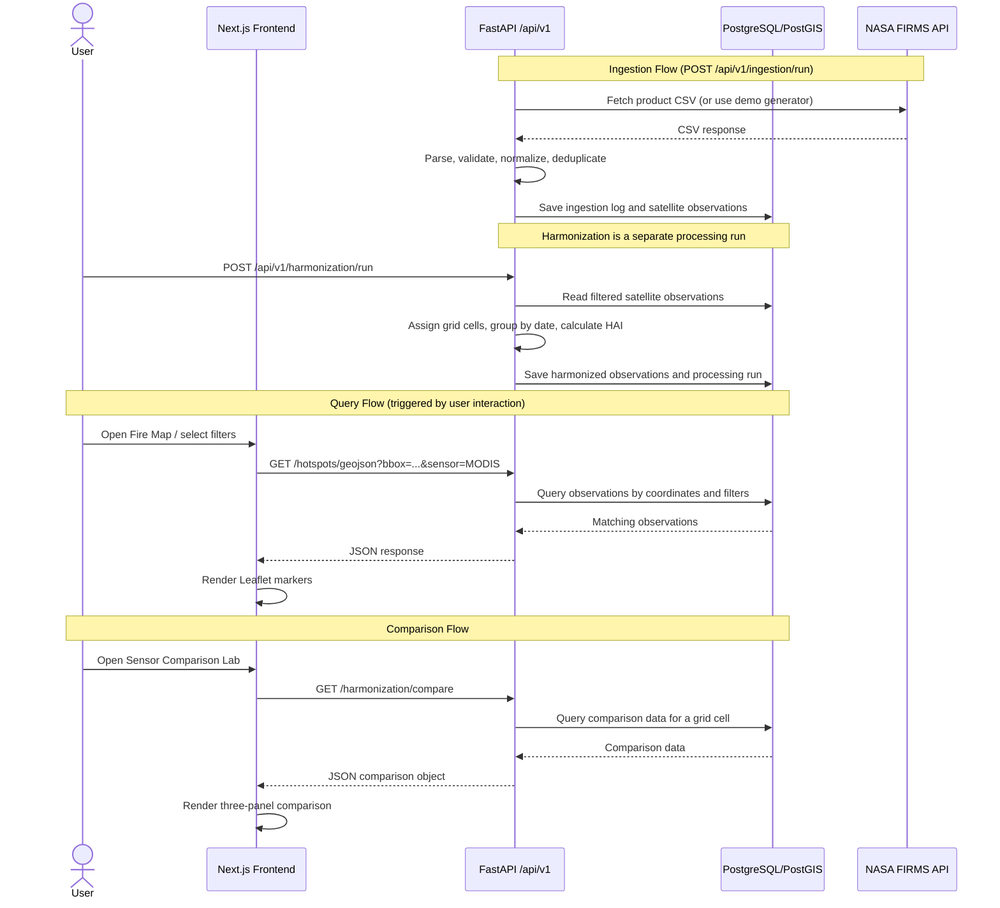
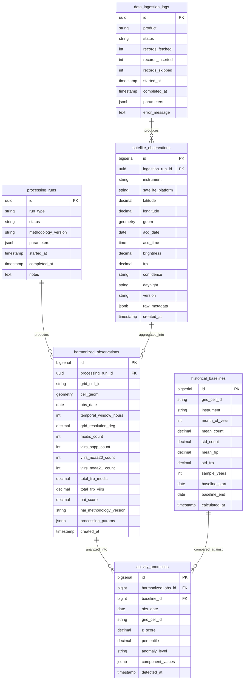
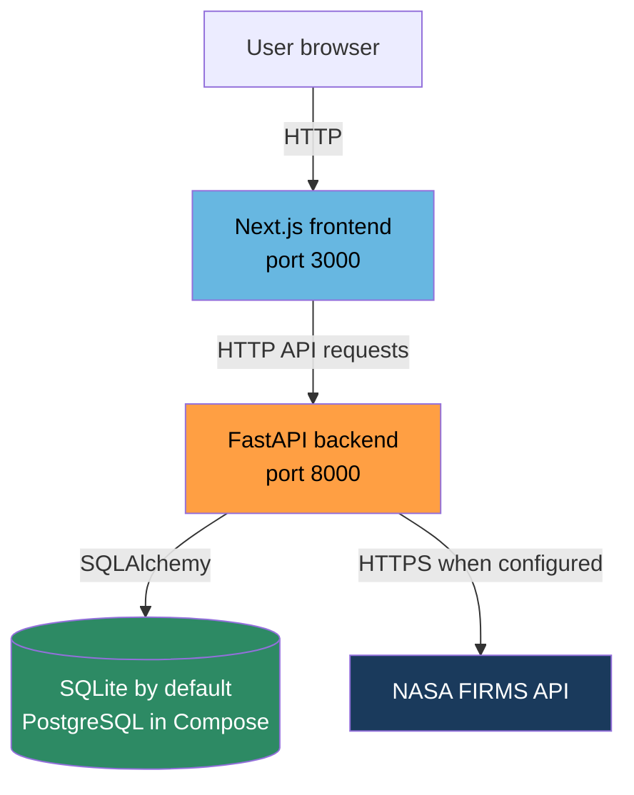
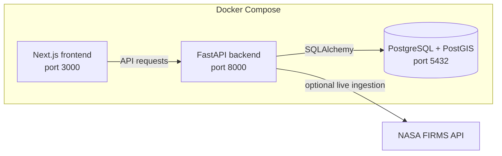

# FireDNA — System Architecture
## NASA Space Apps Challenge 2026

**Version:** 1.0.0  
**Date:** November 10, 2026

---

## 1. Architecture Overview

FireDNA is a **modular monolith**: one FastAPI backend contains separate API, service, ingestion, harmonization, and analytics modules. SQLite is the local-development default; Docker Compose uses PostgreSQL/PostGIS. The frontend is a Next.js application.

### Design Principles
1. **Separation of concerns** — ingestion, processing, harmonization, and API layers are independent Python modules.
2. **Scientific transparency** — raw satellite data is never discarded; all derived metrics store methodology version and parameters.
3. **Explicit demo mode** — synthetic data is visibly labeled when no FIRMS key is configured or a demo run is requested.
4. **Portable development** — the same SQLAlchemy models support local SQLite and the Compose PostgreSQL database.
5. **Progressive enhancement** — the frontend works with partial data; empty states are handled gracefully.

---

## 2. High-Level System Architecture



---

## 3. Component Architecture

### 3.1 Backend Component Diagram



### 3.2 Frontend Component Diagram



---

## 4. Data Flow Diagram



---

## 5. Database Architecture



---

## 6. Deployment Architecture



### Local Development (Docker Compose)



---

## 7. Technology Justification

| Layer | Technology | Justification |
|---|---|---|
| Frontend Framework | Next.js 14 (App Router) | SSR + SSG support; excellent developer experience; Vercel deployment |
| Language (FE) | TypeScript | Type safety reduces runtime errors; better IDE support |
| Styling | Tailwind CSS + shadcn/ui | Rapid consistent UI development; accessible components |
| Animations | Framer Motion | Smooth transitions without custom CSS complexity |
| Mapping | React Leaflet + Leaflet | Open source; excellent GeoJSON support; clustering plugins |
| Charts | Recharts | React-native; composable; responsive; well-documented |
| Backend Framework | FastAPI | Async Python; automatic OpenAPI; Pydantic validation |
| ORM | SQLAlchemy 2.0 | Industry standard; PostGIS integration via GeoAlchemy2 |
| Data Processing | Pandas + NumPy | Standard scientific Python stack; proven for CSV processing |
| Spatial Processing | GeoPandas + Shapely | Spatial operations without PostGIS dependency during processing |
| Database | PostgreSQL 15 + PostGIS | Industry-standard spatial database; excellent indexing |
| Containerization | Docker + Docker Compose | Reproducible environment; easy demonstration setup |
| Frontend Hosting | Vercel | Zero-config Next.js deployment; free tier |
| Backend Hosting | Render | Persistent services; PostgreSQL managed option; free tier |

---

## 8. Error Handling Strategy

### Backend Error Hierarchy

```
FireDNAError (base)
├── FIRMSAPIError
│   ├── FIRMSAuthError (401 — invalid key)
│   ├── FIRMSRateLimitError (429 — rate limited)
│   └── FIRMSConnectionError (timeout / connection refused)
├── DataValidationError
│   ├── CoordinateValidationError
│   ├── TimestampValidationError
│   └── NumericValidationError
├── HarmonizationError
│   ├── InsufficientDataError
│   └── GridGenerationError
└── DatabaseError
    ├── DuplicateRecordError
    └── SpatialIndexError
```

### Error Response Format
All API errors return:
```json
{
  "error": {
    "code": "FIRMS_AUTH_ERROR",
    "message": "Invalid or missing NASA FIRMS API key",
    "detail": "Configure MAP_KEY in environment variables",
    "timestamp": "2026-11-10T22:00:00Z",
    "request_id": "req_abc123"
  }
}
```

### Frontend Error Handling
- API errors → Toast notification + error boundary fallback UI
- Map load failure → Static tile fallback + user-friendly message
- Empty data → Illustrated empty state with contextual action
- Network timeout → Retry button with backoff indicator

---

## 9. Caching Strategy

| Data Type | Cache Location | TTL | Invalidation |
|---|---|---|---|
| Hotspot GeoJSON (regional) | FastAPI in-memory (LRU) | 5 minutes | New ingestion run |
| Dashboard statistics | FastAPI in-memory | 5 minutes | New ingestion run |
| Historical baselines | PostgreSQL materialized view | 24 hours | Re-run baseline calculation |
| Harmonized grid data | PostgreSQL table | Until next processing run | Manual or scheduled |
| Frontend API responses | React Query client cache | 2 minutes | Query key invalidation |
| Map tiles | Browser + CDN | 7 days | Tile provider TTL |

---

## 10. Scalability Considerations

**Current MVP (Hackathon Scale)**
- Single FastAPI process
- PostgreSQL single instance
- In-process data processing
- Regional data only (Bangladesh + South Asia)

**Production Scale (Post-Hackathon)**
- Multiple FastAPI workers behind nginx
- PostgreSQL read replicas
- Celery + Redis for async data ingestion jobs
- Partitioned satellite_observations table by date
- PostGIS spatial indexes on geometry columns
- Global coverage with bbox-limited queries
- CDN for static assets

---

## 11. Security Considerations

| Concern | Mitigation |
|---|---|
| NASA API key exposure | Environment variable only; never in frontend code or git |
| SQL injection | SQLAlchemy ORM with parameterized queries |
| XSS | React's default JSX escaping; Content-Security-Policy header |
| CORS | Explicit allowlist of frontend origins |
| Rate limiting | Backend rate limit on ingestion trigger endpoint |
| Data integrity | Input validation via Pydantic; coordinate bounds checking |

---

*Document version 1.0.0 — FireDNA System Architecture*
