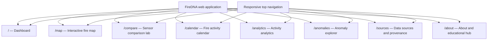

# FireDNA — UI/UX Design Specification
## NASA Space Apps Challenge 2026

**Version:** 1.0.0  
**Date:** November 10, 2026

---

## 1. Design Philosophy & Brand Identity

### 1.1 Brand Identity
- **Name:** FireDNA
- **Tagline:** *Understand Fire. Connect Data. Protect Our Planet.*
- **Domain:** Satellite Fire Monitoring and Environmental Data Analytics.
- **Core Concept:** Just like DNA encodes the fundamental blueprint of living organisms, "FireDNA" decodes and connects the multi-satellite signatures (spatial, temporal, and radiative energy) of active fires across our planet.

### 1.2 Target Audience & Tone
The design balances **scientific credibility** with **educational accessibility**:
- **Students & Curious Learners (Age 12+):** Clear visual hierarchy, plain-language explanations, contextual "Did You Know?" tooltips, interactive exploration, and intuitive legends.
- **Researchers & Domain Specialists:** Uncompromised access to raw sensor metadata, Fire Radiative Power (FRP), acquisition timestamps, confidence classifications, and data export.
- **General Public & Decision Makers:** At-a-glance regional summaries, seasonal fire trends, and transparent anomaly alerts.

> [!NOTE]
> **Kid-Friendly != Cartoonish**: We avoid childlike cartoon illustrations or excessive gamification. Instead, we use clean typography, clear diagrams, vibrant natural accent colors, friendly microcopy, and interactive visual feedback that inspires scientific curiosity.

---

## 2. Visual Design System

### 2.1 Color Palette

| Token Name | Hex Code | Role & Usage |
|---|---|---|
| **Deep Space Navy** | `#10243A` | Primary brand color, headers, sidebar, map background, high-contrast dark surfaces |
| **Forest Green** | `#2D8A64` | Environmental elements, baseline indicators, safe/normal activity status |
| **Atmospheric Sky** | `#67B7E1` | Secondary accents, informational badges, links, temporal controls |
| **Solar Flare Orange**| `#FF9F43` | Moderate thermal anomalies, VIIRS detections, elevated activity warnings |
| **Danger Flame Red** | `#E85D5D` | High FRP hotspots, severe anomalies, critical indicators |
| **Parchment Cream**  | `#F7F6EF` | Primary page background, light card surfaces, soft contrast |
| **Pure White**       | `#FFFFFF` | Card foreground, modals, tooltips, popup backgrounds |
| **Slate Gray**       | `#64748B` | Secondary text, borders, subtle dividers, muted metadata |

#### Semantic Color Rules
- **Fire Observations:** Strictly reserved for `#FF9F43` (VIIRS / moderate) and `#E85D5D` (MODIS / high FRP / critical).
- **Harmonized Activity Index (HAI):** Multi-tier gradient (Green `#2D8A64` → Blue `#67B7E1` → Orange `#FF9F43` → Red `#E85D5D`).
- **UI Chrome & Text:** Deep Space Navy `#10243A` on Cream `#F7F6EF` for optimal WCAG AA contrast (ratio > 7:1).

### 2.2 Typography
- **Primary Typeface:** `Inter`, system fallback `-apple-system, BlinkMacSystemFont, "Segoe UI", Roboto, sans-serif`.
- **Monospace Typeface:** `JetBrains Mono`, `Fira Code` (for coordinates, timestamps, FRP numbers, API paths).
- **Scale:**
  - Hero Display: `36px` / `2.25rem`, Bold (700)
  - H1 Page Title: `28px` / `1.75rem`, SemiBold (600)
  - H2 Section Header: `20px` / `1.25rem`, SemiBold (600)
  - H3 Card Title: `16px` / `1.0rem`, Medium (500)
  - Body Text: `14px` / `0.875rem`, Regular (400), Line height 1.6
  - Small / Caption: `12px` / `0.75rem`, Regular (400)
  - Stat Numbers: `32px` - `40px`, Bold (700), Monospace or Tabular figures

### 2.3 Iconography & Components
- **Icon Library:** `Lucide React` (clean 2px stroke, minimal style).
- **Components:** Built on top of accessible `shadcn/ui` primitives (Radix UI).
- **Card Styling:** `rounded-xl`, subtle borders (`border-slate-200/60`), soft elevation shadows (`shadow-sm` on rest, `shadow-md` on hover).
- **Motion:** `framer-motion` for page transitions, tab switches, and accordion expansions (150ms-250ms ease-out). No disorienting animations.

---

## 3. Information Architecture & Navigation

The layout follows a persistent responsive layout with a top navigation bar (or collapsible sidebar on desktop) and responsive bottom drawer / hamburger on mobile.

---

## 4. Detailed Page Specifications

### 4.1 Page 1: Home Dashboard (`/`)
- **Hero Section:**
  - Headline: *"Understand Our Planet's Fires"*
  - Subtitle: *"Explore satellite observations, discover fire patterns, and understand how our planet changes through NASA MODIS and VIIRS data."*
  - Quick Region Selector: `Bangladesh (Default)`, `South Asia`, `Global View`.
  - Primary CTA: *"Launch Interactive Fire Map"* (Direct navigation to `/map`).
  - Secondary CTA: *"Enter Sensor Lab"* (Navigation to `/compare`).
- **Real-Time Key Metrics (Cards):**
  - Total Hotspots Detected (Last 24h / 7d)
  - MODIS Observations Count
  - VIIRS Observations Count
  - Harmonized Grid Cells Analyzed
  - Data Freshness Status indicator (e.g., "Updated 2 hours ago | NASA FIRMS NRT")
- **Visual Highlights:**
  - Mini Interactive Overview Map of Bangladesh & South Asia.
  - Recent Fire Activity Sparkline (Past 30 days).
  - Anomaly Alert Banner (Flags any recent cell with Z-score > 2.5).
  - Educational Spotlight Card: *"Why does VIIRS see more fire points than MODIS?"*

---

### 4.2 Page 2: Explore Fire Map (`/map`)
The flagship geospatial visualization interface.
- **Map Viewport:**
  - Base: Leaflet with high-clarity CartoDB Positron (light) or CartoDB Dark Matter tiles.
  - Default Center: Bangladesh `[23.6850° N, 90.3563° E]`, Zoom Level `7`.
- **Layer Controls (Floating Panel):**
  - Toggle: `MODIS (1km)` [Red-Orange Markers]
  - Toggle: `VIIRS (375m)` [Yellow-Orange Markers]
  - Toggle: `Harmonized Grid (0.1°)` [Semi-transparent polygonal cells with HAI color coding]
  - Confidence Filter: `All`, `Nominal & High`, `High Only`
  - Day/Night Filter: `All`, `Daytime Only`, `Nighttime Only`
  - Date Picker: Single day or range (up to 10 days for NRT).
- **Performance Optimization:**
  - Leaflet marker clustering (`react-leaflet-cluster`) for >500 points to prevent DOM lag.
  - Bounding box API query triggers on pan/zoom end.
- **Hotspot Interactive Popup:**
  - Title: Satellite & Instrument (e.g., `VIIRS — Suomi-NPP`)
  - Coordinates: `23.412° N, 90.125° E`
  - Detection Time: `2026-11-08 07:42 UTC (Daytime)`
  - Fire Radiative Power (FRP): `18.4 MW`
  - Confidence: `Nominal (74%)`
  - Educational Tooltip: *"What is a Hotspot?"* (Explains that it is a thermal anomaly detected by infrared sensors, not necessarily a structure fire).

---

### 4.3 Page 3: Sensor Comparison Laboratory (`/compare`)
The core scientific innovation showcase of FireDNA.
- **Interactive Three-Column Layout:**
  - **Column 1 — MODIS (Terra & Aqua):**
    - Resolution: ~1 km at nadir (up to 2 km at edge of scan)
    - Detection characteristics: Proven 20+ year record, higher FRP threshold (~50 MW).
    - Map viewport highlighting MODIS raw points.
    - Total detection count & total FRP.
  - **Column 2 — VIIRS (Suomi-NPP, NOAA-20, NOAA-21):**
    - Resolution: 375 m constant resolution across swath.
    - Detection characteristics: High spatial detail, detects smaller/cooler fires (~5 MW).
    - Map viewport highlighting VIIRS raw points.
    - Total detection count (typically 3x-8x higher) & total FRP.
  - **Column 3 — FireDNA Harmonized Framework:**
    - Common Grid: 0.1° (~11 km equal spatial cells).
    - Harmonized Activity Index (HAI): Composite metric factoring detection density, maximum FRP, and observation confidence.
    - Unified spatial cell view showing co-detections and sensor agreement.
- **Educational Bridge:**
  - Comparative Bar Chart showing daily detection discrepancy side-by-side with harmonized score.
  - Interactive Cell Inspector: Select any grid cell to view how MODIS and VIIRS detections inside that cell were combined into the HAI score.

---

### 4.4 Page 4: Fire Activity Calendar (`/calendar`)
- **Annual Matrix Grid:**
  - GitHub-style contribution calendar displaying daily fire activity across 365 days.
  - Heatmap gradient: Pale cream `#F7F6EF` → Soft orange `#FF9F43` → Deep red `#E85D5D`.
  - Selector: Year selector (Historical comparisons) and Instrument selector (`All`, `MODIS`, `VIIRS`).
- **Interactive Tooltip:**
  - Date, Total Hotspots, Dominant Sensor, Maximum FRP.
- **Seasonal Insight Highlights:**
  - Automatically flags known regional fire seasons (e.g., Post-monsoon dry season burning in South Asia, March–May pre-monsoon agricultural fires).

---

### 4.5 Page 5: Activity Analytics (`/analytics`)
- **Interactive Recharts Visualizations:**
  1. **Daily Hotspot Trend:** Multi-line chart (MODIS vs VIIRS vs Harmonized Daily Index).
  2. **Monthly Climatology:** Bar chart comparing current year monthly totals against historical monthly averages.
  3. **FRP Distribution Histogram:** Log-scale distribution of fire radiative power across sensors.
  4. **Day vs Night Breakdown:** Donut chart showing diurnal detection patterns.
- **Export Toolbar:** One-click CSV and JSON data export for researchers.

---

### 4.6 Page 6: Anomaly Explorer (`/anomalies`)
- **Purpose:** Identify statistically unusual fire activity without misleading sensationalism.
- **Anomaly Scorecard:**
  - Calculated Z-Score: $\frac{\text{Observed} - \mu_{\text{historical}}}{\sigma_{\text{historical}}}$
  - Historical Percentile: Relative rank against historical observations for that calendar month.
  - Categorization Badge:
    - `Normal Variation` (Z < 1.5) — Green
    - `Elevated Activity` (1.5 ≤ Z < 2.5) — Yellow
    - `Unusually High Activity` (2.5 ≤ Z < 3.5) — Orange
    - `Extremely Unusual Activity` (Z ≥ 3.5) — Red
    - `Insufficient Baseline Data` — Gray
- **Contextual Transparency Notice:**
  - Explicit warning: *"Statistical anomalies indicate unusual satellite-detected thermal energy compared to baseline averages. They do not confirm uncontrollable forest fires or human disasters. Agricultural stubble burning or clearing can cause elevated anomaly scores."*

---

### 4.7 Page 7: Data Sources & Provenance (`/sources`)
- **Full Scientific Attribution:**
  - NASA FIRMS (Fire Information for Resource Management System)
  - MODIS Land Science Team / VIIRS Atmosphere & Land Teams
  - Direct links to official NASA EOSDIS documentation.
- **Product Metadata Table:**
  - Product ID, Satellite, Orbit Type, Spatial Resolution, Latency, API Endpoint used.
- **Freshness & Provenance Tracker:**
  - Shows when the backend last queried NASA FIRMS, number of records ingested, and processing run IDs.
- **Demo Mode Indicator:**
  - Transparent banner stating whether the currently viewed data is live NASA FIRMS API data or synthesized demo data.

---

### 4.8 Page 8: About FireDNA & Educational Hub (`/about`)
- **Project Mission & Space Apps Challenge context.**
- **Interactive FAQ:**
  - *"What is Fire Radiative Power (FRP)?"*
  - *"Why do different satellites overpass at different times?"*
  - *"Can satellites see fires through clouds?"*
  - *"How does FireDNA calculate the Harmonized Activity Index?"*
- **Team Attribution & Open Source License (MIT).**

---

## 5. Accessibility & Responsive Specifications

- **WCAG 2.1 Level AA Compliance:**
  - All text meets minimum contrast ratio of 4.5:1 (large text 3:1).
  - All interactive elements possess explicit `aria-label` attributes.
  - Full keyboard navigability (Tab, Enter, Escape for dialogs/popups).
- **Responsive Breakpoints:**
  - Mobile (`< 640px`): Single column cards, collapsible map drawer, bottom tab bar.
  - Tablet (`640px - 1024px`): 2-column dashboard cards, side-by-side sensor preview.
  - Desktop (`> 1024px`): Full 3-column Sensor Lab, persistent navigation sidebar, split-screen map with filter controls.
- **Graceful Degradation:**
  - Loading skeletons (`Skeleton` component) for all charts and map layers.
  - Empty states with friendly illustrations and actionable buttons when no fires are detected in the selected bounding box or date range.

---

*Document version 1.0.0 — FireDNA UI/UX Design Specification*
